# Neo-Mutual Organisation

## 1. Purpose and status

**What it is.** The backbone of the Neo-Mutual Organisation is a network of savings and loan units with a social programme. Each unit is owned by its members and holds its own money. Its members save together, lend to one another, and commit themselves to one another and to the development of their community. Units join together into units of units by the same rules that people use to join a unit. One set of rules, written as smart contracts, holds for all of them. The name covers the whole: the rules, the units, and the first unit, which deploys the rules and holds the starting pool of capital. "The first unit" and "the organisation" mean that one unit.

**What it is meant to become.** The backbone is meant to carry more than savings and loans. On it the organisation intends to build mutual institutions that the same members own: a mutual building society, a mutual bank or savings bank with a fuller range of financial services, a mutual healthcare provider, and a mutual insurance company. This document describes the backbone. None of the four is designed yet (14.3).

**What it is built on.** The model starts from what six lending systems have in common: Grameen Bank, BRAC, the Raiffeisen societies of Germany, the caisses populaires of Quebec, and the credit unions of the United States and of Britain. It keeps what they share and departs from them in ten stated ways (section 17). Face to face is kept. What is new is the digital part: smart contracts, no permission needed to take part, and incentives meant to hold up under attack.

**Where it is recorded.** Each decision, with its reason and its evidence, is in `docs/reset/design-model.md`. The frame it fills is `docs/reset/abstract-model.md`. This document adds no decision to those. If it differs from the design model, the design model is right. Appendix A says where each part is recorded.

**Status.**

- It is a design. Nothing is built and nothing has been tested (section 18).
- It sets no amounts. Every size and rate is a parameter (16.7).
- The mechanism of governance is not designed. Until it is, each decision of a unit is taken by a threshold or quorum of its active members (section 5).
- The social programme is part of the backbone. Its charter is yet to be defined, and in this draft the protocol requires none (5.3).
- A line marked **(proposed)** is a recommendation that the owner of the design has not yet decided. Everything else is decided, with the degrees of firmness listed in section 18.

**How to read it.** A member is written as "she". Unless a line says otherwise, what is said of her holds for a member that is a unit. Growth and progress are counted by events and thresholds, and never by a length of time.

## 2. The model in brief

A person joins a unit when members who have met her vouch for her, pledging part of their own share, and when she pays up a share of her own. She saves, and she may borrow. Up to what her own money covers she borrows on that. Above it, other members stand surety and pledge part of their shares. The unit decides each loan. A contract keeps the books, holds the money and pays it out.

Interest on loans is the unit's income. It pays the savers, covers the loans that are not repaid, and may leave a surplus. Part of the surplus is kept and lent again. The rest rewards growth by rule, or is used as the members decide.

Units join units of units in the same way: vouched for, with a pledge, and a share paid up. A unit of units lends to its member units that are short, holds the spare money of those that have more than they can lend, checks that its member units are made of separate real people, and sponsors new units. The first unit of units is the organisation.

Two rewards pay for growth, and both are paid only from surplus that the growth itself produced. Members who vouch for a newcomer, and the newcomer, earn a share of the surplus she brings. A unit that sponsors a new unit earns a bounded share of that unit's surplus once it can stand on its own.

The savings and loans are the means. A unit is meant to carry a social programme as well: a charter its members sign, loans for the purposes it names, and a part of its surplus for the issues it wants to win. On that backbone the organisation intends to build a building society, a bank, a healthcare provider and an insurer, each a mutual.

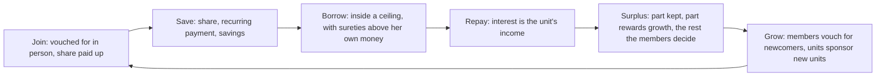

Ten statements carry most of the model.

1. A member is a person or a unit, and the rules are the same for both.
2. Nobody joins without members who vouch with their own money, and without paying in.
3. Only members borrow, and a unit lends only to its members.
4. A loss falls first on the borrower, then on those who pledged, then on the unit that chose to lend, then on whoever lent to that unit.
5. No fund pays out by rule. Every exposure is a share someone paid up, a pledge someone made, or a loan a unit chose to make.
6. Nobody is paid for each loan or out of interest as it comes in. Work and growth are rewarded only out of surplus.
7. A unit of units checks its member units at live meetings drawn at random, and the layer above audits the checks.
8. A member is known inside her unit and to nobody outside it.
9. Meeting in person is for passages: admission, becoming active, founding. Everything else may be done at a distance.
10. Anyone may form a unit. Access to the pool, the organisers and the rewards comes with being admitted to a unit of units.

## 3. Structure

### 3.1 The unit

- **A member is a person or a unit.** A person is treated as a unit of one.
- **A unit is a set of members with its own treasury.** Every unit has the same capabilities. No unit is a branch of another.
- **The rules do not depend on what a member is.** "Regional" and "branch" are names for what a unit does. They are not kinds of unit.
- **A unit may belong to several units or to none.** Units combine case by case, with any units anywhere.
- **The number of layers is an outcome.** The design does not fix it.
- **The organisation is the first unit of units, and the pool is its treasury.** It is a unit like any other. It also writes and deploys the contracts, and a change to the rules is decided by it. How it decides is put off with the rest of governance.

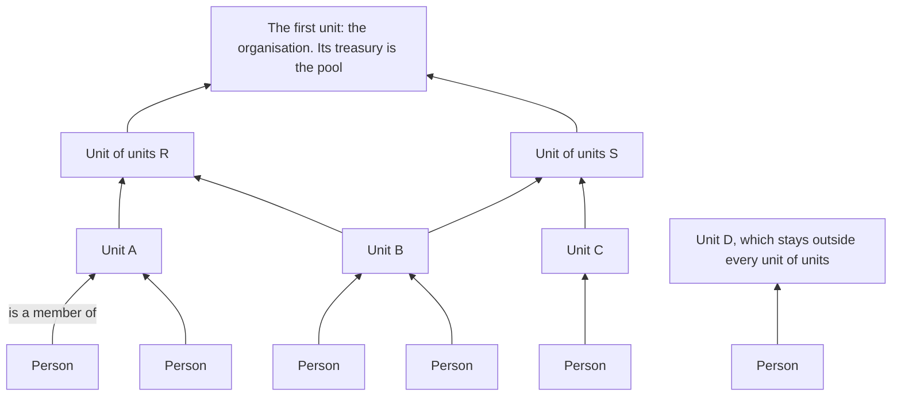

### 3.2 Where a unit is not a person

The rules are the same, and three things differ in fact.

- **A unit can pay out its own members and leave its debt behind.** A person cannot. So what a unit owes comes first: a unit that owes cannot pay out its members' shares below what it owes.
- **A unit's members may all be one person.** The ledger cannot show it, and such a unit keeps a perfect record. The outside check exists for this (section 13).
- **People meet face to face. Units do not have to.** Units deal with one another by any means.

### 3.3 What runs it

- **Contracts.** Everything runs as smart contracts on a blockchain. A unit's treasury is, in concept, an account that needs several signatures. The contract takes in money, records it, pays it out and reports. Its sums always add up, so the books keep themselves.
- **Exchange.** A peer-to-peer protocol exchanges ordinary money and crypto. Active members help other members move between the two.
- **Tooling named by the owner.** A zero-knowledge virtual machine that holds private and public state, and `muster`, which handles the account of several signatures and acts as a state channel in which members agree to the rules.
- **Design and implementation.** This document says what must hold. Whether a rule is enforced as a rule the contract verifies or as a proof is implementation, and is not part of the model.

A rule in a contract reaches only what the ledger shows. Whether a member is a real and separate person, whether a meeting was held, and what a loan was used for are outside it. Vouching, pledges and the outside check carry those.

### 3.4 Open to all, and what that means

Nobody's permission is needed to form a unit or to use the contracts. Joining a unit still needs the consent of its members. A unit may stay outside every unit of units. It then has no call on the pool, on organisers or on the rewards, and no unit of units checks it.

On such a system identities cost nothing to make: one person can appear as many. No reward in this model is paid for an identity as such. Each is tied to something a false member cannot supply cheaply: a paid-up share, the pledges of members who met her, and surplus that her own money produced.

### 3.5 Privacy

A member is known to the other members of her unit, and to nobody outside it. The same holds at every layer: a unit is known inside the units it belongs to. What others need to rely on is shown without names. A member can show that she is a member, and that she has been counted once in a decision or a check, without showing which member she is.

One thing is a fact about people and not about code. A checker or auditor at a live meeting sees who is in the room. That is the price of the check, and a unit agrees to it when it joins a unit of units.

## 4. Members

### 4.1 Who may join

The model must work in any environment, so there is no means test and no fixed place. A person comes in by two things, and both are needed: members who vouch for her, and a share she pays up. Paying up the share is the proof of a habit of saving. The applicant does not set the boundary of membership. The unit's members do.

### 4.2 Three statuses

| Status | What it allows | What it takes |
| --- | --- | --- |
| Guest | Coming to open meetups and to the group chat | Nothing |
| Member | Saving, paying, and borrowing up to what her own money covers | Being vouched in at a meeting in person, and a paid-up share |
| Active member | Vouching, standing surety, counting in the unit's decisions, taking the unit's commitment | Granted at a passage in person. Kept by a recurring payment into her share. The unit may add events of its own |

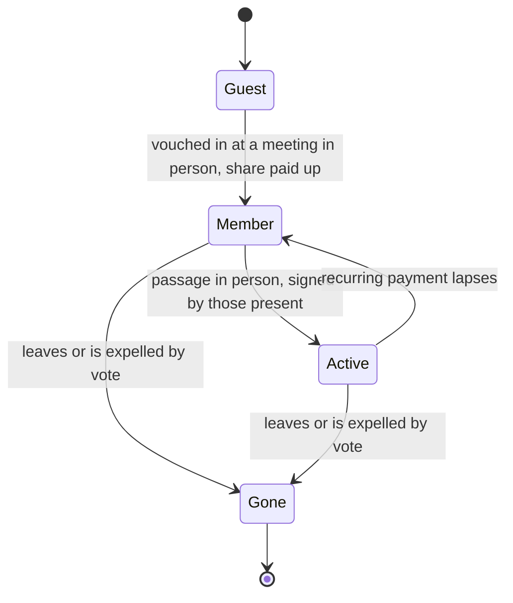

- **A member who only saves need not attend anything.** Saving and using the services do not depend on meetings.
- **Credit above her own money is not a status.** It follows her ceiling and needs sureties (section 6). It does not need attendance.
- **Active status is granted in person and kept by payment.** If payment alone made a key active, one person with many keys could keep up many small payments and hold a majority of a unit's decisions. So the status is granted only at a passage in person, and the payment keeps it.
- **The amount does not weigh.** An active member counts once, whatever she pays.
- **A lapse costs active status and not membership.**

### 4.3 Admission

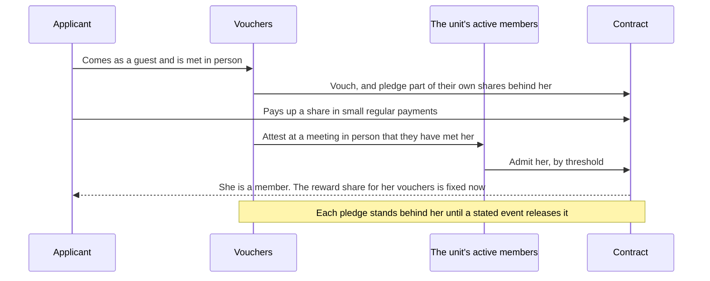

- **Members vouch.** The number of vouchers needed is a parameter. Only active members vouch.
- **A voucher pledges part of her own share** behind the member she vouched for. The pledge is released by a stated event. How far the pledge reaches is a parameter, between part of her share and all she holds in that unit.
- **The unit admits.** Nobody outside the unit admits a member.
- **The rule is the same for a unit that joins a unit of units.** Member units vouch on a threshold and pledge, the new unit pays up a share, and the unit of units admits it. That admission is how a unit is recognised (section 11).
- **There is no course.** Paying up the share shows the habit of saving and shows that she can use her keys and the exchange. Borrowing opens when the share is paid up, which is an event and not a wait.

### 4.4 What a member pays in

| What | Who | Terms |
| --- | --- | --- |
| Share | Every member | Paid up in small regular payments. It stays in for as long as she stays |
| Recurring payment | Every active member, for as long as she is active | Into her share. Any amount she chooses, above a floor the unit may set |
| Savings | Any member, by choice | They raise her ceiling |
| Fee | Members of a unit that has voted one | It belongs to the unit and is its income |

A saving is the member's own, and the unit owes it back. The recurring payment is a saving and not a fee: it is hers, it stays in with her share, it is lost first on her own loans, and it raises her ceiling. It gives the unit steady money to lend, and it is something the contract can see, as attendance is not.

### 4.5 Losing membership and leaving

- **Expulsion** is by vote of the members.
- **On leaving**, the contract sets off what she owes before it pays her out: a loan, and the unearned part of any reward advanced to her (11.4). A reward that was accruing on her lapses.
- **A unit that owes** cannot pay out its members' shares below what it owes.

## 5. Meetings, decisions and rules

### 5.1 Meetings

A meeting in person is for a passage. There are three, and each is recorded as an event signed by those present.

| Passage | What happens |
| --- | --- |
| Admission | Her vouchers attest that they have met her |
| Becoming active | A member is granted active status |
| Founding | A unit is formed |

Meetings are also where members come to know one another and where saving is encouraged. Everything else may be done at a distance and at any hour: paying, saving, discussion in a group chat, decisions by signature. A unit sets its own cadence of meetings. The protocol fixes none.

A signed record of a passage does not prove that the signers are separate people. One person with many keys can sign it alone. The record gives a checker something to test. It is not the defence.

### 5.2 Decisions

- **A unit decides by a threshold or quorum of its active members.** This holds for admitting a member, making a loan and signing for the treasury.
- **In a unit of units, a member unit acts through a person it names.**
- **(proposed)** The borrower and her sureties do not count towards the threshold that decides her loan.
- **Elected offices.** The six systems elected leaders from among the members for fixed terms. The model keeps that, and its form waits on the design of governance.
- **A change to the rules** lies with the first unit, which deployed the contracts.

### 5.3 The social programme and the charter

The savings and loans are one half of the backbone. The other half is a social programme: what members promise one another, and what a unit does for its community beyond lending. Grameen and BRAC each tied one to membership. The four credit-union systems did not. The intent here is community development: finding issues that can be won, and building out mutual organisations for insurance, housing, food, healthcare and additional financial services.

**Where it stands.** The protocol does not require a social programme in this draft, but is intended to have one. The Neo-Mutual Organisation's own charter is yet to be defined. Until it is, a unit that wants a programme uses three things the model already has.

- **A charter.** A unit may adopt a charter that a person signs on admission or on becoming active: promises of membership, and a commitment to community development. The organisation may publish one for units to take up.
- **Loans.** A unit names the purposes it lends for, and housing can be one. A project that several people or units take on together can be a unit formed for it, which joins and borrows as any unit does.
- **Surplus.** The part of the surplus that the members decide can pay for an issue the unit wants to win.

Nothing in the protocol pays for civic work.

**Reference examples.** Grameen's Sixteen Decisions and BRAC's seventeen promises are copied in full in appendix B. They are examples of the form, and not a draft of ours. Three things can be read from them.

- **Each is a short list of promises in the first person plural.** The source says that Grameen's borrowers adopted theirs.
- **Each mixes two kinds of promise.** Some are about conduct inside the organisation: discipline, loyalty, attending, saving, repaying. Others are about the household and the community: housing, health, clean water, schooling, helping one another, investing together.
- **Each is of its place and time.** Some promises would not carry over. BRAC's promise to attend weekly meetings has no counterpart here, where a member who only saves need not attend.

## 6. Savings and loans

### 6.1 The loan

Savings and loans are the product. Only members borrow. A loan is for a purpose of a kind the unit's rules name.

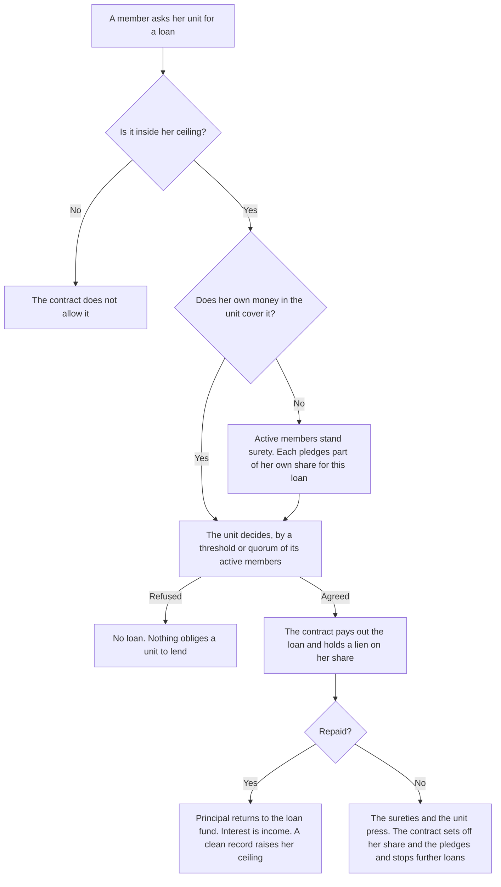

- **The ceiling.** Each borrower's ceiling is worked out by rule from what she has paid into that unit and her record there. The contract does not let a unit lend above it. It follows her own record only, and not the record of any group she is in.
- **Her own money is lost first.** What a unit lends to a member is capped against what she has paid in, and that is the first thing a loss takes.
- **Above her own money, sureties.** Fellow members pledge part of their shares for that loan. A surety's liability ends at what she pledged. A voucher's pledge and a surety's pledge are one mechanism.
- **No liability of all the members for one member's loan.**
- **Her standing with other members is the main security.** They vouched for her, they stand surety for her, and they decide.
- **The unit decides each loan, case by case.** Nothing obliges a unit to lend.
- **Pressing for repayment.** The sureties and the unit press. The contract sets off what is pledged and stops further loans. Members may vote to expel.
- **Principal repaid goes back to the loan fund** and is not income.

### 6.2 Where the loan money comes from

The loan money is the members' shares and savings. A unit that is short borrows from a unit it belongs to, and at the top of that chain is the pool. The pool lends and does not grant, and that holds for every unit: what a unit passes to a member is a loan. No deposits are taken from non-members.

### 6.3 Rates and their bounds

A unit sets the rate it charges and the rate it pays. The protocol fixes no gap between them and takes nothing. The bounds are set in three layers, each inside the one before.

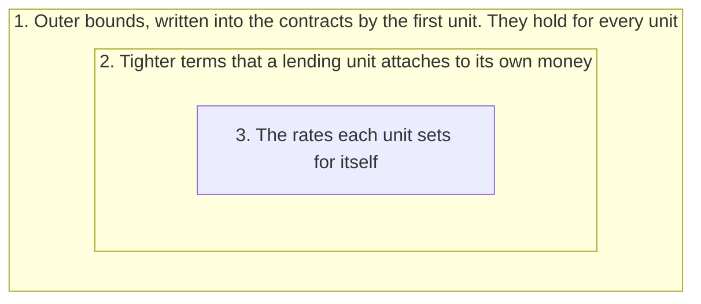

- **A layer can tighten the bounds and cannot loosen them.**
- **The outer bounds** are there so that a captured unit cannot set abusive terms.
- **Terms travel with money.** A unit that lends to a member unit can attach conditions to that money, agreed at admission or with the loan, and the contract enforces them.
- **A unit that vouches sets no bounds.** Its part is to pledge.
- **The rhythm of payments** is also set by the unit, inside bounds in the contracts. A payment goes to the contract at any time and needs no meeting.

## 7. Money and ownership

### 7.1 The unit's money

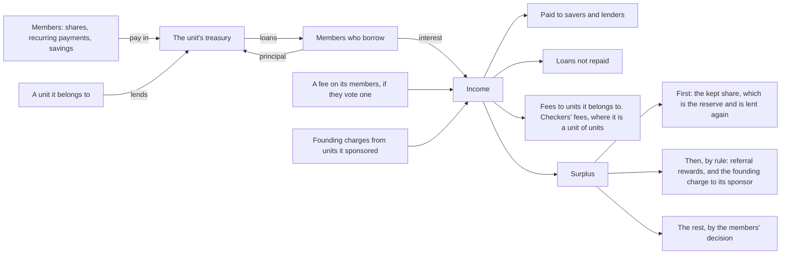

### 7.2 The surplus

- **A stated share of each period's surplus is kept** before any other use. The share is a parameter.
- **By rule**, after the kept share: the referral reward (section 12) and the founding charge (section 11).
- **The members decide the rest.** It may be a dividend on shares, a reward for members' work, an issue the unit wants to win, or sponsoring a new unit.

### 7.3 The reserve

The reserve is not a separate store of money. It is the part of what the unit holds that the unit owes to nobody: its loans and cash, less what it owes to its members and its lenders. The money behind it is lent out with the rest. It grows by the kept share of the surplus and falls when a loss is charged to it. No member can withdraw from it: not as a dividend and not on leaving. If a unit is wound up, what is left after its debts and its members' shares and savings are paid goes to a unit it belongs to, and not to its members.

### 7.4 Fees

A unit may charge its own members a fee, by their decision. A unit of units is a unit, so its members, which are units, may vote a fee in the same way. No unit can charge another from above. Besides the gap on money lent, the fee and the founding charge, nothing passes from a unit to a unit it belongs to.

### 7.5 How a member's saving earns

- **Lent in her own unit.** It is loan money for the unit's members, and the unit earns the gap on it.
- **Passed up when the unit cannot lend it.** The unit saves its spare money in a unit it belongs to, which lends to member units that are short.
- **Returned through the surplus**, kept and lent again, or used as the members decide.

### 7.6 No money placed outside

In this version of the design a unit places no money outside the network. The limit belongs to the design and not to a unit's life: it holds for a unit of any age. Money placed outside is beyond the order of loss in section 8, because nobody vouched for the borrower and no pledge stands behind it.

## 8. Who bears a loss

**The principle.** A loss on a loan falls on the unit that made the loan. A unit can lose more than it holds only if another unit enabled it, by vouching for it or by lending to it, and whoever enabled it is liable for that loss.

**Inside one unit.** A unit that has not borrowed can lose no more than it holds. A loss on one of its loans is met in this order:

1. The borrower's own share, and the pledges behind the loan.
2. The unit's reserve.
3. Its members' own claims on it. **(proposed)** Among those claims, shares are lost before savings.

**Between units.** A unit U borrows from R, a unit it belongs to, and does not repay.

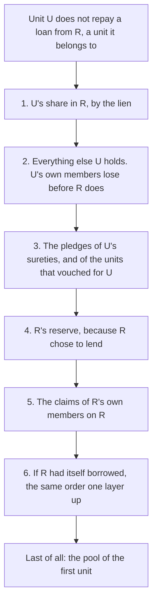

- **Nobody outside the system bears a loss.** The chain ends at the first unit.
- **A person's liability ends at what she has paid in and pledged**, because a contract can reach nothing else. A unit's reaches all it holds.
- **The three roles stay together.** The members screen, the members decide, and the members' own money loses. That holds at every layer.

## 9. The work and who does it

| Work | Who does it | How it is paid |
| --- | --- | --- |
| Taking in money, recording it, paying it out, reporting | The contract | Not paid |
| Finding and vouching for members, weighing loans, pressing for repayment, helping members move between cash and crypto | The unit's active members | Unpaid. The members may reward it out of surplus |
| Organising a new unit | An organiser of the sponsor | By the sponsor, on terms the sponsor sets (11.5) |
| Checking a member unit | Other member units, drawn at random | A fee from the unit of units (section 13) |
| Auditing the checks | The unit that lends to the unit of units | It acts from its own interest as lender |
- **No unit has a salaried worker** for its regular work.
- **Nobody is paid for each loan, or out of interest as it comes in.** Those who decide loans and are paid from the interest would have a reason to lend more.
- **A unit may reward its members' work only out of surplus**, after its losses and after the kept share, by the members' decision.

## 10. Units of units

A unit of units is a unit whose members are units. It is run by its members, as any unit is. No unit directs another.

**What it may do.** Holding spare money, lending, organising, supplying and checking are not given to a kind of body. A unit does them or does not, and is known by what it does. There may be any number of units of units, and a unit may belong to several.

| Function | How |
| --- | --- |
| Recognises a unit | By admitting it: member units vouch and pledge, and it pays up a share |
| Holds spare money | A member unit saves its spare money there |
| Lends to a unit that is short | From that money and from what it borrows itself, on its own terms |
| Checks its member units | Section 13 |
| Sponsors new units | Section 11 |

### 10.1 Money through layers

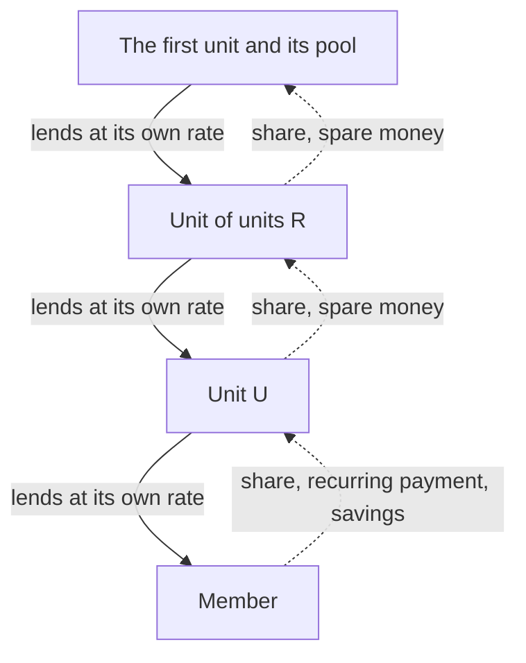

- **A unit of units lives on its own gap, as any unit does.** So money carries one gap for each unit it passes through. A member's savings lent in her own unit carry one. Money from the pool carries one for each layer.
- **Depth has a price.** Money that reaches a person through several units costs more than her own unit's savings. That limits how far the pool reaches, and keeps a unit's lending mostly on its own members' money.

### 10.2 Why lending through a layer is kept

A unit of units lends to a member unit, which lends on to its own members at its own rates. Four things in the model stand behind that.

- **The lender can verify.** A borrowing unit shows its lender that every loan it makes is inside the terms, without showing who borrowed.
- **The lender can set rules.** Terms travel with what is lent and the contract enforces them: the ceilings, the bounds on rates, and lending to admitted members only.
- **The borrowing unit loses first** (section 8).
- **Nobody is paid from the margin as it comes in** (section 9).

## 11. Founding a unit

### 11.1 The steps

Anyone may form a unit. The sponsor of a new unit is the unit of units that it joins. The sponsor's members do the organising. At the start the organisation trains the organisers, and the first sponsor is the organisation.

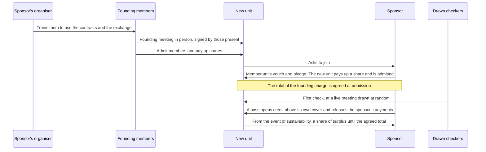

The founding meeting is a passage and not a check: the sponsor's organiser is present, and an organiser does not check the unit she organised. The unit's first check is the first one made by drawn checkers.

A unit's own maturation is a chain of events. The check is placed in the chain here because a pass is what opens credit above the unit's own cover (13.2).

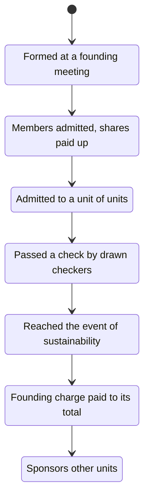

### 11.2 Who pays, and the founding charge

1. **The sponsor pays for the organising.** It uses its surplus above the kept share, or an ordinary loan from a unit it belongs to, inside its own ceiling. At the start the money is the pool's. The pool has then earned nothing, so its first founding spend comes from its capital. It is founding cost all the same, to be earned back.
2. **A founding charge.** When the new unit reaches a stated event of sustainability, such as its reserve reaching a stated level, it begins to pay its sponsor a stated share of its surplus. It pays until a stated total is reached, and then stops.
3. **The charge never touches members' money.** It is paid only out of surplus. It is not a debt: if the unit closes, the charge lapses, and it ranks after everything in the order of loss.
4. **The total is bounded.** The new unit and its sponsor agree it at admission, inside a bound in the contracts tied to what the new unit has paid in. It is owed to the direct sponsor only, and nothing passes further up. Inside the sponsor, a stated part of it goes to the member units that vouched for the new unit.

The first loan money is lent and not given. A new unit can lose more than its members' own money only if a unit lent to it, and that unit carries the early losses in the order of section 8. It is also the unit that earns the charge, so it gains if the new unit succeeds and loses if it fails.

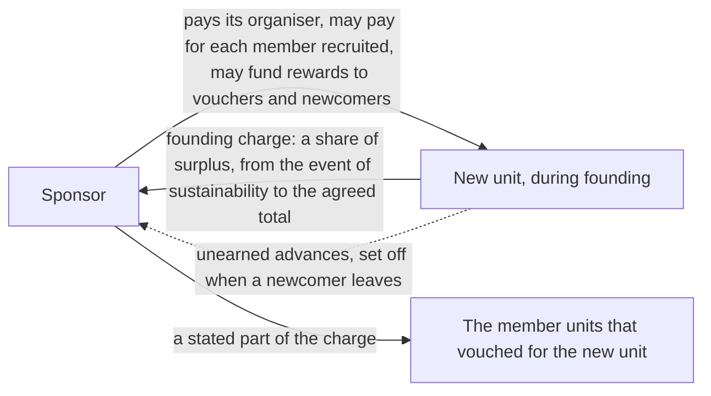

### 11.3 Paying for members during founding

The referral reward (section 12) is paid from surplus, and a new unit has none at the time it most needs members. So a sponsor may pay for member growth in a unit it sponsors, as part of the founding cost it already carries.

- **Two forms, and a sponsor may use both.** It may pay its organiser for members recruited. It may fund the reward to the vouchers and the newcomers in the new unit.
- **It is the sponsor's choice** for each unit it sponsors. The amounts are agreed with the new unit.
- **Both count as founding cost.** The sponsor earns them back only through the founding charge. They are not a debt of the new unit or of its members.
- **The total is bounded**, inside a bound in the contracts tied to what the new unit has paid in.
- **It is released on events that take effort**, such as a share paid up and recurring payments kept. The larger part is released later.
- **It ends when the new unit has a surplus of its own.** From then the referral reward applies.
- **None of the pool is spent on growth without earning it back.** The organisation is a sponsor like any other. There is no subsidy, and no budget for one.

### 11.4 An advance is a claim until it is earned

This applies to the reward a sponsor funds for vouchers and newcomers.

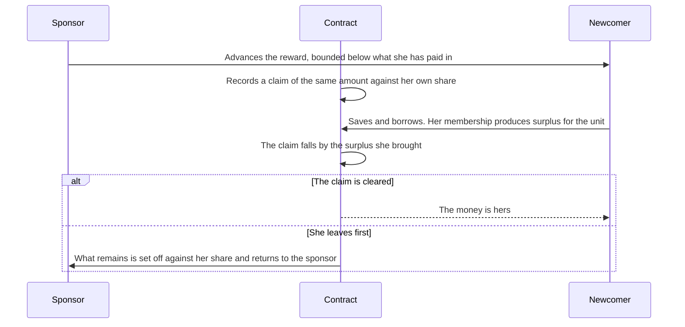

- **The voucher's side is the same.** The unearned part of her reward for that newcomer is set off against the voucher's share.
- **The advance is the referral reward paid early.** A newcomer earns one reward and not two: what her membership earns clears the claim first.
- **What it changes.** A person with a second key gains nothing: she has the use of money she must return. A member who stays loses nothing. A member who leaves early returns the unearned part.

### 11.5 The organiser's three payments

They are kept apart.

| Payment | Rule |
| --- | --- |
| Pay for the organising work: training the founders and holding the founding meetings | It is the sponsor's money, so the sponsor sets the terms. The protocol sets no rule. Two forms are suggested as normal, and neither is required: a salary, or pay by result. A sponsor may combine them |
| Pay for each member recruited | Held as a claim until that member's advance is earned. The claim sits on the share of whoever is the member of the sponsor: the organiser, or the member unit she acts for |
| A part of the founding charge, for having vouched for a unit that lasts | Paid from the new unit's real surplus. It needs no claim |

Both suggested forms for the organising work were used in the six systems: a salaried worker formed the groups at Grameen and BRAC, and both tied a worker's pay to results. Each has its own weak point for the sponsor to watch. Keys of the organiser's own cannot raise a salary, and the risk is paying for work that was not done. A result counted in members is the second payment in the table and falls under its rule. A result that is an event in the new unit's life, such as its admission to the sponsor or a pass by drawn checkers, cannot be raised by the number of keys, and only a wholly false unit collects it.

### 11.6 Why founding pays

Let C be the cost of one attempt, p the share of attempts that reach sustainability, and T the total charge. Sponsoring pays when p × T is more than C.

- **Founding pays where the unit lasts, and only there.** A sponsor earns nothing from a unit that never has a surplus, and it loses its pledge if that unit does not repay a loan.
- **The units that last cover the ones that do not.**
- **Nothing is paid that is not covered.** The charge is paid by the new unit out of what it earned. A false unit can pay it only with real money of its own.
- **Sponsors compete.** Founders may choose their sponsor, which presses the total down towards C ÷ p.
- **The cost has to be low.** The model closes only where organising is cheap: done by the sponsor's own members, on terms the sponsor sets, with the contract keeping the books.
- **The network can measure p and the payback.** The ledger records earnings and retention by the cohort a member or a unit joined in.

## 12. The referral reward

The aim is to reward the growth of the network, in units that last and in members of them, while keeping it sound against attack.

### 12.1 The rules

1. **The reward comes only from surplus the newcomer brought.** That is the surplus her own saving and borrowing produced for the unit, counted after any loss on her own loans. Nothing is paid by rule out of a pot or from other members' money. It is paid after the unit's losses and the kept share. The one payment ahead of income is a sponsor's, during founding (11.3).
2. **Attribution is by pledge.** Those rewarded are the members who vouched for her and pledged behind her. No referral code is needed. A voucher earns on the member she vouched for, and on nobody that member later brings in.
3. **It accrues.** From a stated event, the unit pays a stated share of that surplus until a stated total is reached, and then stops. There is no lump sum at a threshold. It is not a debt: it lapses when she leaves, and nothing is paid in a period without a surplus. The unit sets the share inside bounds in the contracts, and it is fixed for each newcomer at her admission.
4. **It is paid to both, and to the persons.** It goes to the vouchers and to the newcomer herself, and not to the unit's treasury.
5. **It is one rule at every layer.** For a unit that joins a unit of units, the surplus it brings its sponsor includes the founding charge it pays. So the member units that vouched for it receive their stated part of the charge by rule.
6. **It rests on no proof that members are separate people.**

### 12.2 The surplus a member brought

A unit's surplus is one figure for the whole unit. Three things rest on one member's part of it: this reward, the clearing of a sponsor's advance, and the organiser's pay for each member.

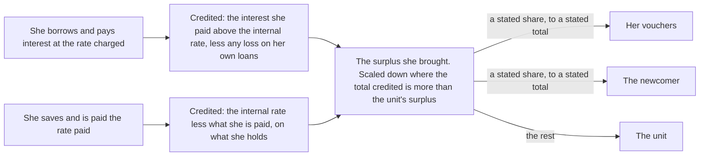

- **The unit has one internal rate**, between the rate it pays savers and the rate it charges borrowers. It is a parameter.
- **A borrower is credited** with the interest she paid above that rate, less any loss on her own loans.
- **A saver is credited** with the difference between that rate and what she is paid, on what she holds in the unit.
- **The total credited is scaled down** where it is more than the unit's surplus after its losses and the kept share, as when money lies unlent.

### 12.3 Why this form

- **It pays only where the unit lasts.** Neither a voucher nor a sponsor earns from a member or a unit that joins and leaves.
- **There is no pot, so a newcomer dilutes nobody.** She brings her own money and the unit earns on it.
- **Growth pays at every layer without a tree.** Each payment reaches one level and is bounded.
- **A group that fakes a newcomer pays itself with its own money.** Everything the group receives, on both sides together, is less than the surplus its own money produced.

## 13. The outside check

### 13.1 What it is for

The contract keeps the books. The check covers what the ledger cannot show, and chiefly whether a unit's members are separate people. Most of what a false unit could take is already secured by shares, pledges and claims. What a wrong pass still gives it is credit above its own cover, a count in the decisions of the unit of units it joined, and the release of its sponsor's payments during founding. So the check protects the lender, the vouchers and the fellow members, and they are the ones who run it and pay for it.

### 13.2 The rules

1. **A unit of units checks its member units.** It is the lender's check, made regular.
2. **The check is a live meeting.** Each member drawn proves her membership against a fresh challenge, in the checker's presence. The proof shows that she is a member and has not been counted before in this check, and not which member she is.
3. **The timing and the sample are drawn at random in each epoch.** Units drawn in the same epoch meet in the same window, so that one group of people cannot stand in for several units.
4. **Checkers are drawn at random from the other member units.** A checker is a member unit, acting through a person it names. The vouchers, the sureties and the organiser of the unit checked are excluded.
5. **The layer above repeats a random share of the checks.** A unit that lends to the unit of units audits its checks, because it loses if that unit's members are false. The chain ends at the first unit. The share audited does not fall as the rate of passes rises.
6. **A pass opens three things:** credit above the unit's own cover, its count in the decisions of the unit of units, and the release of the sponsor's payments during founding.
7. **The unit of units pays the checkers**, from its gap or from a fee its members vote. A checker's fee is held as a claim on its share until the audit window has passed, and is lost if the audit contradicts the check.

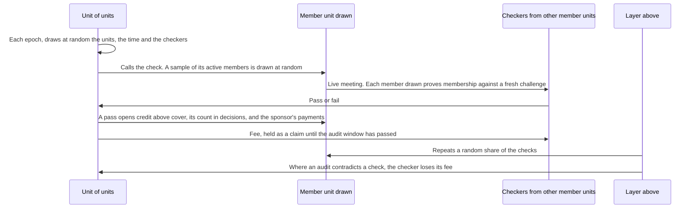

### 13.3 A sample of the active members

A check is of a sample of the unit's active members, in every check and whatever the unit's size. The active members are the ones who vouch, stand surety and count in decisions. A key that only saves gains nothing from a pass.

- **The sample is drawn at random when the check is called.** Neither the unit nor the checker chooses it.
- **A member drawn who does not appear counts against the unit.** Otherwise a false key would simply stay away.
- **What a sample costs.** A unit in which a few active keys are false passes a check in which none of them is drawn. A pass therefore shows that most of a unit's active members are separate people, and not that all are. A unit that is wholly or largely false is caught. The chance of catching a few false keys rises with the size of the sample and with each further check.

### 13.4 Who checks the checkers

- **The layer above**, by rule 5. It acts from interest: it lends to the unit of units.
- **The draw can be verified.** An audit that was skipped can be seen. An audit that was dishonest cannot.
- **Defaults show the truth later.** A unit that passed and then fails as a false unit stands on the record against the checker that passed it and the auditor that confirmed it.
- **A unit that belongs to several units of units is checked by each**, and the results can be compared.

Checkers compared only with each other measure their agreement and not their accuracy, which is why an audit from the layer above is required. Where nearly every unit is honest a checker has little reason to look, which is why the share audited must not fall with the rate of passes. A checker posts nothing new: its fee is held, and no deposit is asked.

**Held back.** A checker could pledge part of its share behind each pass, as a voucher does. It raises the price of a bribe from the fee to the pledge. It also punishes a checker who was honestly deceived and makes "fail" the safe answer. It is the fallback if the requirement in test 5 (section 18) fails at the chosen sizes.

## 14. How the system grows

Growth is two events: a unit gains a member, and a unit is formed. A unit that joins a unit is the first event again, one layer up.

### 14.1 What pays for growth

| Event | Who earns | From what | Limit |
| --- | --- | --- | --- |
| A person joins a unit that has a surplus | Her vouchers and she herself | A share of the surplus she brings | A stated total. It lapses when she leaves |
| A person joins a unit during its founding | The same, paid early by the sponsor | The sponsor's founding cost, held as a claim on the recipient's share until earned | A bound tied to what the new unit has paid in |
| An organiser recruits a member during founding | The organiser | The sponsor's founding cost, held as a claim until that member's advance is earned | The same bound |
| A sponsored unit reaches sustainability | The sponsor | A share of the new unit's surplus | The total agreed at admission |
| The same | The member units that vouched for the new unit | A stated part of that charge | Inside the same total |

The unit that gained the member keeps the rest of what she brings, and the new unit keeps the rest of its own surplus.

### 14.2 Size

The protocol sets no cap on the size of a unit. No payment and no count in the model depends on a unit staying small. The expected shape is a large membership around a group of active members.

**One asymmetry.** A unit earns on its own member for as long as she stays. It earns on a unit it sponsors only up to the bounded total of the charge. Other things equal, a unit earns more by admitting a person itself than by helping her group to form a unit.

- **Vouching is the limit that works.** A person is admitted only when active members who have met her pledge part of their own share. Beyond the people its members know, nobody will pledge, and a unit's own growth stops. For those people the only way a unit earns anything is to sponsor their unit. So sponsoring begins to pay where a unit's own growth runs out.
- **A new unit takes from nobody.** It brings its own money. An existing unit loses nothing when another exists, and could not prevent one.
- **Dividing a unit is not growth.** No reward is paid for it.

### 14.3 What the backbone is meant to build out into

The savings and loan units and their social programme are the backbone. The organisation intends to build four mutual institutions on it, owned by the same members.

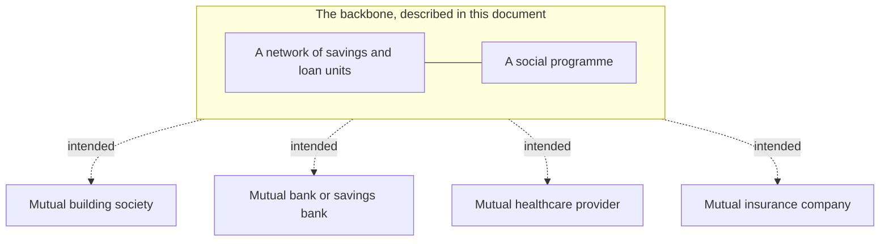

None of the four is designed. The intent is the owner's. The last two columns of the table are this document's notes and not decisions: they say what the backbone already offers, and what each institution would need that the backbone does not have.

| Institution | What it adds | What the backbone already has towards it | What it would need that the backbone does not have |
| --- | --- | --- | --- |
| Mutual building society | Saving for a home and borrowing to build or buy one | A unit may name housing as a purpose it lends for. A project can be a unit formed for it, which joins and borrows as any unit does | Loans that are large against what a member has paid in and that run for many years. Security on the house itself, which a contract cannot hold |
| Mutual bank or savings bank | A fuller range of financial services. The backbone is already part of the way there | Savings, loans, payment into a contract at any hour, exchange between ordinary money and crypto, and spare money held and lent between units | The services themselves, which are not yet named. Two present limits bear on it: no deposits are taken from non-members, and no money is placed outside the network |
| Mutual healthcare provider | Health services that the members own | A part of the surplus that the members decide. A unit formed for a project. A charter that can carry promises about health | Paid and qualified staff, where no unit now has a salaried worker. Income from services, where a unit's income is interest and fees. A way to check a service, where the outside check tests only that members are separate people |
| Mutual insurance company | Members pool a risk and are paid when it falls on them | Members who pay in regularly. A reserve. The outside check | A common fund that pays out by rule, which the backbone on purpose does not have (section 2, statement 5). A way to verify a claim, which the ledger cannot show |

The one opening for all four is already in the model: a unit is known by what it does, and a project that several people or units take on together can be a unit formed for it.

One pointer comes from the source of appendix B, and not from the six systems as they are described for this model. Around its Sixteen Decisions, Grameen offered low-interest loans for improved housing, and health and education programmes for members and their families.

## 15. Security

### 15.1 The approach

- **Identities cost nothing to make**, and the model has no proof that members are separate people. Admission carries the defence: a paid-up share, and pledges by members who met the applicant.
- **Nothing is paid from a shared pot.** Each reward is paid from surplus that the rewarded growth produced, so a false member can be paid only with real money of her own.
- **Every exposure is chosen.** No fund pays out a loss that a unit did not choose to be exposed to.
- **A point of security is a rule** with the attack it answers, what the attack costs and what it gains.
- **An attack is scored on everything the colluding group receives**, and not on one payment.

### 15.2 Attacks and what stands against them

| Attack | What it costs | What it gains | What stands against it |
| --- | --- | --- | --- |
| One person keeps up small payments under many keys, to hold a majority of a unit's decisions | The payments | Nothing | Active status is granted only at a passage in person. Payment keeps it and does not grant it. The amount does not weigh |
| A member vouches for a second key of her own and moves her saving and borrowing to it | A second share paid up. A threshold of active members who vouch, pledge and attest that they met her | A bounded rebate on activity she would have done anyway | The stated total for each key. The loss is the admitting unit's, and only surplus it would have kept. This leak is not zero. It is the price of the reward |
| A newcomer borrows a large sum and pays it straight back in as savings | The margin between the rate charged and the rate paid | Part of her own margin back | The internal rate credits her with what she herself paid and no more |
| Join, collect, leave, join again |  | Nothing | The reward is paid only on surplus really produced, and lapses on leaving |
| A newcomer borrows, pays interest and defaults | Her share, and her vouchers' pledges | No reward | The surplus she brought is counted after the loss on her loans. The vouchers' pledges are lost first |
| A unit re-forms as its own child | The founding charge, which the new unit pays | Nothing | No pot pays a unit for being new |
| An organiser forms a unit of keys of her own | For each key a share, the payments and the passages in person | The sponsor's payments, up to the bound. Those paid for members are returned when the keys leave. What is left is the pay for the organising work | Advances are claims. The bound is tied to what was paid in. Release is on events. The organiser is known to the sponsor. Only the sponsor loses, and no more than it chose |
| One person forms units filled with her own keys, joins a unit of units, and borrows or votes there | A share and pledges for each unit | Credit above cover, and a count in decisions | Vouching with a pledge. The cap on lending against what is paid in. The outside check. This is test 5, not yet run |
| A unit's active group lends the savers' money to itself | Their shares, their pledges as sureties, their standing | The loans | Sureties pledge their own shares. The ceiling caps each loan. This is test 7, not yet run |
| A unit keeps its surplus small to avoid the founding charge | Lower rates for borrowers or more paid to savers | A smaller charge | Not answered. This is test 6, not yet run |
| A captured unit sets abusive terms |  |  | The outer bounds in the contracts |

### 15.3 Stated limits

- **The chain of checks stops at the first unit.** Nobody inside the model checks its audits. Its own capital is last in the order of loss, which is its reason to audit honestly. If the first unit is captured or absent, nothing inside the model corrects it.
- **Hired bodies.** People paid to attend pass a live meeting. A random time makes that costly and does not prevent it.
- **Bribery.** A checker's stake is its fee.
- **Distance.** A live check needs checkers who can reach the unit, so a unit of units can take only the members its own members can reach.
- **A sample.** A pass shows that most active members are separate people, and not all.
- **What a contract cannot see.** A rule reaches only what the ledger shows.

### 15.4 Risks the model carries

- **Knowing one another fades without regular contact.** The model prices it where it matters: credit above a member's own cover always needs sureties with pledges at risk.
- **Unpaid work wears out.** The contract removes the book-keeping, which was the largest unpaid job, and a unit may reward work out of its surplus.
- **A unit may prefer a member to a unit.** It may admit strangers on thin vouching to keep the income. What holds that back is the size of the voucher's pledge.
- **No system has paid a late, covered reward for bringing in a member.** Whether it moves anyone is not known.
- **The rule that attributes surplus to one member is new** and untested. Where the internal rate is set decides how much is credited to savers and how much to borrowers.
- **Whether the gap of a unit of units is enough to live on** is not known.

**What would show it failing.**

- **The founding charge:** units grow large while the founding of new units stays low and credit above cover for each member falls.
- **The referral reward:** units stop gaining members while the reward is offered and the founding of new units also stays low. Also: rewards paid on newcomers whose vouchers' own saving fell by a like amount, which is the mark of a second key.

## 16. The model for a model builder

Sections 16.3 to 16.5 are read from the frame for this model. They are book-keeping and were not separately decided.

### 16.1 Bodies

| Body | Definition |
| --- | --- |
| Member | A person or a unit admitted to a unit, which pays in and may borrow |
| Guest | A person who comes to open meetups and the group chat and is not admitted |
| Active member | A member granted that status at a passage, who keeps up a recurring payment |
| Unit | A set of members with its own treasury. It meets, holds the money, lends and counts its own surplus |
| Unit of units | A unit whose members are units |
| The first unit | The organisation. The first unit of units, whose treasury is the pool, and which deploys the contracts |
| Voucher | An active member who vouches for an applicant and pledges behind her |
| Surety | An active member who pledges part of her share behind one loan |
| Sponsor | The unit of units that a new unit joins, and that pays for its organising |
| Organiser | A person who acts for the sponsor to help start a unit |
| Checker | A member unit drawn to check another member unit, acting through a person it names |
| Contract | The code that holds the money, keeps the books and enforces the rules |

### 16.2 Roles

Each role of the frame, with the one answer this model gives.

| Role | Holder |
| --- | --- |
| 1. Supplies the loan money | The members, by shares and savings. A unit it belongs to, by loan. In the end the pool |
| 2. Screens or backs the borrower | Her vouchers at admission and her sureties for each loan, with pledges. The active members who decide |
| 3. Admits a member | The unit's active members, by threshold, after members vouch and a share is paid up |
| 4. Decides a loan | A threshold or quorum of the unit's active members |
| 5. Does the regular work | The contract. For the rest, the active members, unpaid |
| 6. Checks from inside | The contract, for the books. No other holder is named |
| 7. Checks from outside | Each unit of units it belongs to, by drawn checkers, audited by the layer above |
| 8. Bears a loss | The borrower, those who pledged, the unit's reserve, its members, then its lender, in the order of section 8 |
| 9. Keeps the surplus | The unit: a kept share to reserve, rewards by rule, the rest by the members' decision |
| 10. Recognises a unit | A unit of units, by admitting it |
| 11. Starts a new unit | Anyone. With a sponsor, the sponsor's organiser and the founding members |
| 12. Pays for the organising work | The sponsor, which earns it back through the founding charge |
| 13. Sets the rates and limits | The unit, inside its lender's terms, inside the outer bounds. Each ceiling by rule |
| 14. Holds the unit's spare money | A unit it belongs to. A unit that belongs to none holds its own |
| 15. Presses for repayment | The sureties and the unit. The contract sets off and stops further loans |

### 16.3 Stocks

For one unit, unless the row says otherwise.

| Stock | What it counts |
| --- | --- |
| Members, by status | Members and active members. Guests are not members |
| Members with a loan |  |
| Shares | Paid up by members, with the recurring payments added |
| Savings | Members' savings by choice |
| Loans outstanding, and loans overdue |  |
| Reserve | What the unit holds and owes to nobody |
| Money borrowed | From units it belongs to |
| Held in units it belongs to | Its share and its spare money there |
| Cash | In its treasury |
| Pledges standing | Vouchers' and sureties' |
| Claims standing | Advances not yet earned. Checkers' fees inside the audit window |
| Founding charge | Paid so far, against the agreed total |
| Referral reward | Paid so far for each newcomer, against her total |
| Units, by stage | For the whole system (11.1) |

### 16.4 Flows

Members joining, becoming active, lapsing and leaving. Paid in and withdrawn by members. Lent, repaid, and given up as lost. Interest from borrowers. Fees from members. Paid to savers and lenders. Fees paid to units it belongs to. Checkers' fees. Surplus, the share kept, rewards paid, the founding charge paid and received, and the part the members decide. Advances made, earned and set off. Pledges made, released and lost. Units formed, admitted, passed, sustainable, and closed.

### 16.5 Identities

These hold by definition. They are book-keeping and not behaviour.

- **Members.** Members at the end of a period = members at the start + joined − left.
- **Savings.** Shares and savings at the end = at the start + paid in + interest or dividend credited − withdrawn − set off.
- **Loans.** Loans outstanding at the end = at the start + lent − principal repaid − given up as lost.
- **What the unit holds and owes.** Loans outstanding + cash + what it holds in units it belongs to = members' shares and savings + money borrowed + reserve.
- **Surplus.** Surplus = interest from borrowers + fees from its members + founding charges received − paid to savers and lenders − loan losses − fees and checkers' fees paid.
- **Reserve.** Reserve at the end = reserve at the start + the kept share of the surplus − losses charged to the reserve.
- **Units.** Units at the end = units at the start + formed − closed.
One condition is not an identity. Sponsoring pays when p × T is more than C (11.6).

A unit is out of cash when it can neither lend nor pay a withdrawal. A unit it belongs to relieves that by lending. A unit is insolvent when its losses exceed its reserve, and section 8 says who then pays.

### 16.6 Costs, and who carries each

| Cost | Who carries it |
| --- | --- |
| The regular work | Nobody is paid. The contract and the active members do it |
| Use of the money: what is paid to savers and lenders | The unit, from its interest income |
| Loans not repaid | The order in section 8 |
| Checking | The unit of units, from its gap or a fee its members vote |
| Training during founding | The sponsor, as founding cost |
| Training after founding | No rule in this draft |
| Starting new units | The sponsor, earned back through the founding charge |
| Loss beyond what a unit holds | Whoever enabled it, by vouching or lending. In the end the pool |

### 16.7 Parameters

None is set.

| Group | Parameters |
| --- | --- |
| The unit | Members in a unit. The share of surplus that is kept. A unit's fee on its members |
| Paying in | The size of a share and its instalments. The floor on an active member's recurring payment, and how long a lapse may last. The events a unit adds for making and keeping a member active |
| Admission | The number of vouchers needed. The part of her share that a voucher pledges. The event that releases the pledge |
| Loans | The cap on lending against what a member has paid in. The size, term and instalments of a loan. The rates charged and paid. The outer bounds on rates |
| Founding | The event of sustainability. The share of surplus paid as the charge. The bound on its total. What a sponsor pays for members during founding, the events that release it, and its bound. The part of what a member has paid in that bounds an advance to her |
| Referral reward | The event that starts it. The share of a newcomer's surplus paid. How it divides between her vouchers and her. The bound on its total. The unit's internal rate |
| The check | The length of an epoch. The share of units checked in an epoch. The size of the sample of active members, and how many of those drawn may be absent. The share of checks audited. The length of the audit window. The checker's fee. How much credit above cover a pass opens |

### 16.8 Events

Nothing in the model waits for a length of time. These are the events it turns on: a share paid up; admission; active status granted and lapsed; a voucher's pledge released; a loan repaid or given up; a unit formed; a unit admitted to a unit of units; a pass at a check; an audit window passed; the event of sustainability; the event that starts a referral reward; a reward or a founding charge reaching its total; an advance earned.

## 17. What is taken from the six systems, and what is new

### 17.1 Taken

| The model has | As in |
| --- | --- |
| A boundary of membership that the applicant does not set. Only members borrow | All six |
| Something paid in before borrowing | All six |
| Other members taking part in each loan, and standing as the main security | All six |
| Principal back to the loan fund, interest as income, and a surplus | All six |
| A check from outside the unit, and a body above it | Five of the six |
| Elected members who are not paid | Five of the six |
| A unit that is a body of its own, owned by its members, which decides its loans and bears its losses | The four credit-union systems |
| A share paid up in instalments, and a stated share of surplus kept as reserve | The credit-union systems |
| A reserve that is never shared out, even on winding up | Raiffeisen, the caisses, Britain |
| Sureties who pledge behind a loan | Britain, the United States, Raiffeisen |
| A ceiling worked out by rule from what the borrower paid in and her record | Grameen |
| A regular payment for as long as a member stays | Grameen and BRAC |
| An oath of membership | Grameen's Sixteen Decisions and BRAC's seventeen promises |
| The organisation before the units | Grameen, BRAC, and the Massachusetts association of 1917 |
| A pool that lends and does not grant | Grameen's head office in its first period, and Raiffeisen's Central |
| One count for each member, whatever she pays | The caisses, the United States, Britain |
| A fee paid by a member to her unit, and by a unit to a body above | Four systems for persons, three for units |
| Units that own the bodies above them, belong to more than one, or stay outside | Germany, Quebec, Massachusetts |
| Spare money held above and lent to units that are short | Raiffeisen's Central |
| Rates set by the unit inside an outer cap | Britain |
| An audit that samples | Grameen |

Two things changed within a system, and the model takes a side. Lending through a layer was ended by Grameen and by BRAC and kept by Raiffeisen. The model keeps it, for the reasons in 10.2. Liability of all the members for one member's loan was written by Grameen and not enforced. The model does not have it.

### 17.2 New

No system did these.

| No. | Departure | Nearest thing observed |
| --- | --- | --- |
| 1 | A reward to a newcomer's vouchers and to her, as a share of the surplus she brings | One United States credit union pays a flat sum to both |
| 2 | A unit is paid for sponsoring a new unit, by a bounded charge on that unit's later surplus. A new unit pays back the cost of its own founding | Older units paid for newer ones through dues, in Massachusetts and Quebec |
| 3 | Records, custody of money, payment and reporting done by smart contracts | None |
| 4 | One set of rules at every layer: a person is a unit of one | Units that own the bodies above them |
| 5 | A voucher pledges part of her share behind the member she vouched for | Raiffeisen's members elected newcomers knowing they were liable for them |
| 6 | A member proves that she is a member and is counted once, without being named | None |
| 7 | Checkers drawn at random, paid, and audited by the layer above | Audit by a federation or the state |
| 8 | A loan decided by a threshold of the unit's members, not by an officer or a committee | Unanimous approval by Grameen's group and Center, and by the caisses' Credit Committee |
| 9 | A passage held in person and recorded as an event signed by those present | Grameen's officer tested a new group in person |
| 10 | Three statuses, with active status granted at a passage and kept by a recurring payment | Credit unions where few attend and many only save |

## 18. What is not designed, not decided and not tested

### 18.1 Not designed

- **The mechanism of governance.** How a threshold or quorum is formed, what offices a unit elects, and how the first unit decides a change to the rules.
- **Training after founding.** It has no rule.
- **Placing money outside the network.** Not allowed in this draft. If a later version allows it, it is written as a rule with its risk.
- **Pay for civic work.** The protocol pays for none.
- **The charter.** The organisation's own charter is yet to be defined. Appendix B gives two reference examples.
- **The build-out.** The building society, the bank, the healthcare provider and the insurer are intended and not designed (14.3).
- **Risks and failing measures** are written for the founding charge and the referral reward only. For the other eight departures in 17.2 they are not written.

### 18.2 Not decided

Three lines are proposed and the owner has not decided them.

- Among members' claims on a unit, shares are lost before savings (section 8).
- The borrower and her sureties do not count towards the threshold that decides her loan (5.2).
- A reward that reaches past the direct newcomer either has a bounded form or rests on members being unique. No reward in the model reaches past the direct newcomer, so this is a guard on later changes.

### 18.3 Firmness of what is decided

- **Agreed in the main, and open in their details:** who sets rates and limits and how the ceiling is worked out; the cap on lending against what is paid in; what a member pays in apart from the recurring payment; the lien and the sureties; how repayment is pressed; that no deposits are taken from non-members; the kept share of surplus and what happens on winding up.
- **Follows from what was decided, and not vetoed:** the order of loss; the voucher's pledge for persons; that a unit lends only to its members; that several units of units may exist and none directs another; that spare money is held in a unit a unit belongs to; that the sample in a check is drawn at random and an absent member counts against the unit; that the privacy rule holds at every layer; the part of the founding charge that goes to vouching member units.
- **Everything else in this document** was decided by the owner, or is common to the six systems and was left standing by the owner.

### 18.4 Not stated

Writing the model out as one description showed these. The design does not say them, and this document does not fill them.

- **Whether the share is paid up before admission or after it.** It is stated both ways.
- **The terms on which a member withdraws savings or leaves**, beyond the set-off in 4.5.
- **What a failed check does**, and how long a pass lasts. The rules say what a pass opens.
- **Who checks from inside a unit**, other than the contract for the books.
- **Whether the auditor of a check is paid.**
- **Which unit is the sponsor** where a new unit joins several units of units at once.
- **The order between the referral reward and the founding charge** where a period's surplus does not cover both.

### 18.5 Not tested

Nothing has been tested. Ten tests are set.

1. **One unit's accounts.** Run a unit through the identities for its first years at the chosen sizes and rates. The gap must pay for the savers and the losses, or the shortfall must have a named payer.
2. **The system's accounts.** For a sponsor, p × T must be more than C. For a unit of units, its gap and any fee must cover what it pays out, its losses and its kept share.
3. **The frame's checks as requirements.** The model is read against each thing the six systems were checked for.
4. **Attacks on rewards.** What a member or a unit gains by faking members, splitting or colluding, scored on everything the group receives.
5. **One person behind many units.** The requirement **(proposed)** is that the shares locked, the pledges lost and the expected penalty from checks are more than the credit that is not covered, and that what a wrong pass opens is less than what the checker and the vouchers stand to lose by it.
6. **Avoiding the founding charge.**
7. **The active group and the savers.**
8. **Lending through layers.** Which of a lender's terms the contract can enforce and which it cannot.
9. **The referral reward.** The rebate from a second key, whether the attribution rule can be moved by the member herself, and whether the reward is large enough to matter.
10. **Admitting or sponsoring.** A unit's return from one more member against its return from sponsoring a unit for her and her group.

## 19. Glossary

| Term | Meaning |
| --- | --- |
| Active member | A member who vouches, stands surety and counts in decisions |
| Advance | A reward paid early by a sponsor during founding, held as a claim until earned |
| Audit | A repeat of a check by the layer above |
| Ceiling | The most a unit may lend a member, worked out by rule |
| Backbone | The network of savings and loan units with its social programme, on which the other mutual institutions are meant to be built |
| Charter | The promises a member signs, on admission or on becoming active. The organisation's own is yet to be defined |
| Check | A live meeting at which a drawn sample of a unit's active members prove themselves to drawn checkers |
| Claim | An amount held against a share until it is earned or a window has passed |
| Cover | What a member's own money in the unit secures |
| Epoch | The period in which checks are drawn |
| Event of sustainability | The stated event at which a new unit begins to pay the founding charge |
| Founding charge | A bounded share of a new unit's surplus, paid to its sponsor |
| Gap | The difference between the rate a unit charges and the rate it pays |
| Internal rate | The rate, between those two, by which surplus is attributed to one member |
| Kept share | The share of each period's surplus that goes to the reserve |
| Lien | The unit's first call on a borrower's own share |
| Order of loss | Who bears a loss, and in what order |
| Passage | A meeting in person at which a member is admitted, a member becomes active, or a unit is founded |
| Pledge | Part of a share put behind another member or a loan |
| Pool | The treasury of the first unit |
| Recurring payment | What an active member keeps paying into her share |
| Referral reward | A share of the surplus a newcomer brings, paid to her vouchers and to her |
| Reserve | What a unit holds and owes to nobody |
| Set-off | The contract taking what is owed out of a share before paying it out |
| Share | What a member pays up to join, and keeps in for as long as she stays |
| Social programme | What members promise one another and what a unit does for its community beyond lending |
| Sponsor | The unit of units that a new unit joins and that pays for its organising |
| Surety | A member who pledges behind one loan |
| Surplus | What is left of a unit's income after savers, lenders, losses and fees |
| Unit | A set of members with its own treasury |
| Unit of units | A unit whose members are units |
| Voucher | A member who vouches for an applicant and pledges behind her |

## Appendix A. Where each part is recorded

Sections of `docs/reset/design-model.md`.

| This document | Design model |
| --- | --- |
| 3. Structure | 3 (the brief), 3.1, 5.1 |
| 4. Members | 5.2 (D4, D8), 5.3 (levels of commitment) |
| 1, 5.3, 14.3. The backbone, the social programme and the build-out | 3 (the aim), 5.3 (D15) |
| 5. Meetings, decisions and rules | 5.2 (governance, D5), 5.3 (D11, D15) |
| 6. Savings and loans | 5.2 (D5 to D10), 5.3 (D16, bounds on rates) |
| 7. Money and ownership | 5.2 (D1, D2, the reserve), 5.3 (fees, saving, outside placement) |
| 8. Who bears a loss | 5.2 (who bears a loss, in order) |
| 9. The work | 5.3 (D12, D13) |
| 10. Units of units | 5.3 (lending through layers), 5.4 (D18, D19, D24) |
| 11. Founding a unit | 5.4 (D21 to D23), 5.5 |
| 12. The referral reward | 5.6 |
| 13. The outside check | 5.4 (D20), 5.7 |
| 14. How the system grows | 5.4 (D25), 5.5 (a member of one's own, or a unit one sponsors) |
| 15. Security | 5.3, 5.5, 5.6, 5.7, 8 |
| 16. The model for a model builder | 4, 6, and the frame in `docs/reset/abstract-model.md`, section 15 |
| 17. Taken and new | 4, 5, 7 |
| 18. Not designed, not decided, not tested | 5, 7, 8, 9 |

## Appendix B. Two charters, as reference examples

These are copied as they stand in the sources. They are examples of the form. The Neo-Mutual Organisation's own charter is yet to be defined (5.3).

### B.1 Grameen Bank: the Sixteen Decisions

Source: `references/GrameenGuidelines.md`, lines 2205 to 2221. The source says that Grameen's borrowers adopted them "to inculcate common values that would guide them as members of Grameen in their day-to-day lives and help their families move out of poverty".

1. We shall follow and advance the four principles of Grameen Bank—Discipline, Unity, Courage and Hard Work—in all walks of our lives.
2. We shall bring prosperity to our families.
3. We shall not live in dilapidated houses. We shall repair our houses and work toward constructing new houses at the soonest.
4. We shall grow vegetables all year. We shall eat plenty of them and sell the surplus.
5. During the planting seasons, we shall plant as many seedlings as possible.
6. We shall plan to keep our families small. We shall minimize our expenditures. We shall look after our health.
7. We shall educate our children and ensure we can earn enough to pay for their education.
8. We shall always keep our children and the environment clean.
9. We shall build and use pit-latrines.
10. We shall drink arsenic-free tube well water. If it is not available, we shall boil water or use alum.
11. We shall not take any dowry when our sons marry, nor shall we give any dowry when our daughters marry. We shall keep our Center free from the curse of dowry. We shall not practice child marriage.
12. We shall not inflict any injustice on anyone, nor shall we allow anyone to do so.
13. We shall collectively undertake bigger investments for higher incomes.
14. We shall always be ready to help each other. If anyone is in difficulty, we shall all help him or her.
15. If we come to know of any breach of discipline in any Center, we shall all go there and help restore discipline.
16. We shall take part in all social activities collectively.

### B.2 BRAC: the seventeen promises

Source: `references/brac-operations.md`, lines 1932 to 1948.

1. We will not do malpractice and injustice.
2. We will work hard and bring prosperity to our family.
3. We will send our children to school.
4. We will adopt family planning and keep our family size small.
5. We will try to be clean and keep our house tidy.
6. We will always drink pure water.
7. We will not keep our food uncovered and will wash our hands and face before we take our meal.
8. We will construct latrines and will not leave our stool where it doesn't belong.
9. We will cultivate vegetables and trees in and around our house.
10. We will try to help others under all circumstances.
11. We will fight against polygamy and injustices to our wives and all women.
12. We will be loyal to the organization and abide by its rules and regulations.
13. We will not sign anything without having a good understanding of what it means (we will look carefully before we act).
14. We will attend weekly meetings regularly and on time.
15. We will always abide by the decisions of the weekly group meetings.
16. We will regularly deposit our weekly savings.
17. If we receive a loan we will repay it on time.

# References

The following baselines were descriptions of the comparables models.
Abstract model is the generalisation of credit unions, BRAC & Grameen.
Design model was the neo-mutual design decisions based on the abstract model for our use case.

[grameen-brac-baseline](https://app.notion.com/p/grameen-brac-baseline-f238f96fb65c83fb979801bffa3a23f3?pvs=21)

[credit-union-baseline](https://app.notion.com/p/credit-union-baseline-d9e8f96fb65c834eaa3281fd55e0005d?pvs=21)

[abstract-model](https://app.notion.com/p/abstract-model-f458f96fb65c839cbcd00131d6fb6402?pvs=21)

[design-model](https://app.notion.com/p/design-model-f298f96fb65c83b586d18164c90d0da2?pvs=21)